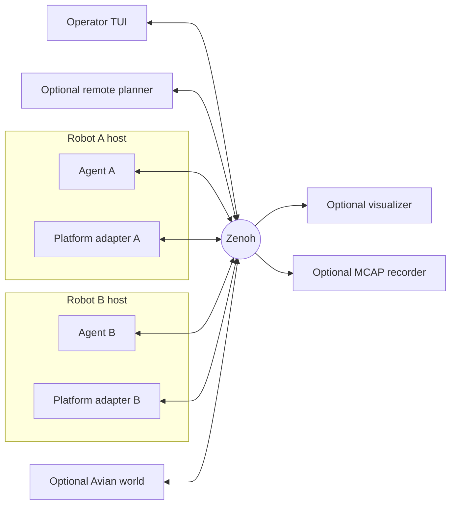
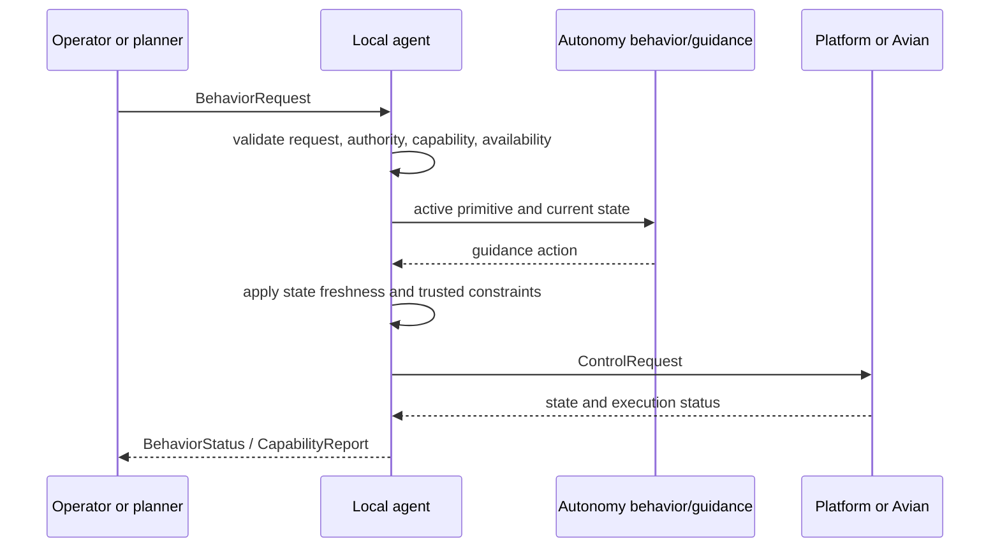

# Architecture overview

The system is organized around one rule: every robot has a local agent, and that agent remains useful without a fleet controller, visualizer, or mission planner.

`cargo run --locked` starts the operator TUI. After setup, the launcher creates one agent process per configured robot and only the supporting processes those agents require. All runtime communication uses agent-scoped Zenoh topics.

## Responsibility boundaries

### Autonomy

`crates/autonomy` is platform-agnostic decision logic. Its intended loop is:

```text
strategy -> planning -> guidance
```

- Strategy decides assignments, roles, or mission-level objectives from mission state and advertised capabilities.
- Planning turns an objective into a sequence or stream of behavior primitives.
- Guidance turns the active primitive and current state into control actions.

Only the behavior and guidance portions are implemented today. There is no planner framework in the runtime. A future strategy or planner may be a Rust module in the local process or a remote peer. Either way, it should publish typed `BehaviorRequest` values and consume status and capability reports.

Autonomy must not import a platform SDK, open Zenoh sessions, own process supervision, or depend on the TUI.

### Agent

`crates/agent` represents one logical robot. It joins the pieces needed to make that robot safe and commandable:

- validates behavior requests;
- enforces operator and autonomy authority;
- checks advertised capabilities and live platform availability;
- tracks state freshness;
- aggregates trusted collision and fault constraints;
- maintains behavior lifecycle and request correlation;
- invokes platform-agnostic behavior and guidance logic;
- publishes generic, agent-approved controls.

The agent is not a platform implementation and not a fleet coordinator. It is the local policy boundary between requested behavior and execution.

### Platform

A platform profile defines what a platform can do. A platform adapter executes generic controls and publishes state and execution feedback.

The current Spot profile lives in `platforms/spot`. It advertises planar navigation, hold, pick, and place, including platform-specific speed and reach limits. A platform that lacks an operation omits that capability. The agent rejects the request before it reaches the adapter, and the TUI shows the action as disabled.

Platform adapters may use different implementation technologies or Python versions. They remain child processes of the local launcher and communicate through the shared contracts. A release contains the target-specific standalone Spot runtime beside the Rust executable; a release-bundle user does not install Python or the SDK. A source checkout uses host Python 3.10 to create and manage an isolated dependency environment when its local dependencies are missing.

### Simulation

`simulation/avian` is an execution backend and shared virtual environment.

- For a simulated agent, Avian owns state, physics, manipulation effects, and environmental collisions.
- For a hybrid agent, hardware owns state and execution. Avian mirrors the reported pose and evaluates virtual-world collisions.

The simulation does not run guidance. It receives an already approved generic control and applies it to the simulated body.

### Middleware

`crates/middleware-zenoh` owns transport mechanics only: Zenoh configuration, session creation, codecs, topic forwarding, bounded queues, and liveliness. It does not decide authority or behavior.

### Operator and observers

`apps/dca` contains the Ratatui operator interface and the local process launcher. The operator can issue any supported primitive and has final override authority.

The visualizer and MCAP recorder are optional, read-only observers. Their absence must not affect an agent. One operator process may observe and command several agents; no second operator is supported at present.

## Runtime topology



The current launcher runs a local stack from one command, but the topic contracts do not require all processes to share a computer. A visualizer can subscribe to agents running on different robot computers. Each agent makes decisions for its own `agent_id`.

## Control flow

The primary control path is:



The original shorthand `planner -> bridge -> behavior -> guidance -> Zenoh -> platform` is close, but it places transport in the wrong part of the design. Zenoh is not between behavior and guidance. The actual ownership is:

```text
strategy or operator
  -> planning
  -> typed behavior request
  -> local agent admission and lifecycle
  -> behavior transformation
  -> guidance
  -> local agent safety decision
  -> generic control request over Zenoh
  -> platform adapter
```

The middleware bridge appears at process boundaries. Pure behavior and guidance code does not know Zenoh exists.

## Capabilities

Capabilities are code-defined by platform crates and passed to each agent by the launcher. There is no inherited primitive set.

Navigation capability includes:

- planar or spatial target dimensionality;
- slow, medium, and fast speed limits;
- position tolerance;
- target-heading support.

Manipulation capability includes:

- pick support;
- place support;
- minimum and maximum reach.

The behavior request keeps its dimensionality. A planar platform cannot accept a spatial target by discarding the third coordinate.

Live `CapabilityReport` values combine these static capabilities with adapter availability. This lets a UI distinguish “not supported” from “supported, but offline.”

## Per-agent backends

Backend is explicit in each agent manifest.

| Backend | Accepted state | Trusted collisions | Processes |
|---|---|---|---|
| `simulated` | Avian state | Avian contacts when enabled | Agent and environment |
| `hardware` | Platform state | Platform faults | Agent, platform adapter, MOCAP support |
| `hybrid` | Platform state | Platform faults and Avian virtual contacts | Agent, platform adapter, environment, MOCAP support |

Hardware disconnection does not silently convert an agent to simulation. The capability report becomes unavailable, actions are disabled, and required-process startup failures are shown in the TUI.

## Operator authority

An operator behavior request immediately pauses autonomy for that agent. This is true even if the requested operation is later rejected as unsupported or unavailable; the robot cannot continue an autonomous action after a human has attempted to override it.

The operator must send `ResumeAutonomy` explicitly. Autonomy does not resume when the operator behavior completes.

## Collision behavior

Environmental wall contacts are level-published constraints with a short expiry. Platform faults do not expire locally.

When a command drives into a wall, the environment publishes a hard stop and the agent issues a stop. If a new navigation request arrives before the previous wall event clears, the agent accepts and retains the request but withholds guidance until the old event clears or expires. The request is then executed without asking the operator to send it a second time.

Driving away from a contact is distinguished from driving into it by projecting the intended direction against the contact normal. Hold does not count as pushing into a wall.

## Object ownership

Object lifecycle is shared state: free or held, with an optional holder agent.

In simulation, Avian owns virtual object state. In hardware operation, the MOCAP object tracker owns tracked-object poses and follows manipulation status. In hybrid operation, Avian mirrors held-object poses from every real platform-state update. A picked object therefore travels continuously with the robot instead of teleporting from its pickup point to the hold or drop pose.

The visualizer interpolates pickup and placement transitions while continuing to follow the authoritative object state. This keeps hybrid display behavior continuous without making the observer an owner of object state.

Manipulation admission remains platform-agnostic. The agent checks the reported arm reach and forward sector before dispatching a request and reports whether a target is too close, too far, or outside that sector. The Spot adapter then validates the exact transformed grip height against its live ground plane before issuing any arm command. It does not move an unsafe target to a different height.

## Source hierarchy

The file hierarchy mirrors the control hierarchy:

```text
apps/dca
  launcher and operator UI
      |
      v
crates/contracts
  shared request, status, capability, state, and configuration types
      |
      v
crates/agent
  per-robot authority, admission, lifecycle, constraints, decision
      |
      v
crates/autonomy
  platform-agnostic behavior and guidance transformations
      |
      v
crates/middleware-zenoh
  process-boundary transport
      |
      +--> simulation/avian
      +--> platforms/spot

sensors/mocap
  independent state producer

observers/visualizer
observers/mcap-recorder
  independent read-only consumers
```

Dependencies are not intended to form one strictly linear chain. Contracts sit below every process, middleware is used at each process boundary, and observers subscribe without participating in control.

## Adding a platform

A first-party platform addition should be small and explicit:

1. Add a platform crate or adapter under `platforms/`.
2. Define its `CapabilitySet`, including all three speed profiles if it navigates.
3. Register the profile in `apps/dca/src/platform_profiles.rs`.
4. Translate generic `ControlRequest` actions into the platform SDK.
5. Publish agent-scoped state, execution status, faults, and a liveliness token.
6. Add the launcher process wiring required by that adapter.
7. Add dedicated contract and adapter tests.

No change to behavior or guidance should be required merely because the SDK is different.
