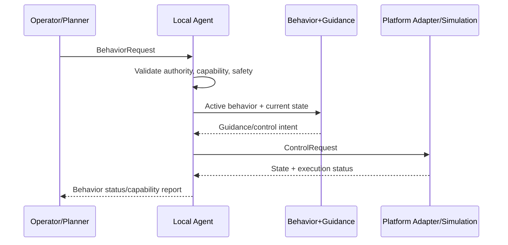

# Distributed Collaborative Autonomy Platform

A Rust workspace for decentralized multi-robot autonomy experiments. Each robot runs a local agent that accepts behavior requests, applies safety/authority checks, and emits platform-agnostic control requests over Zenoh.

## Motivation

This repository focuses on reproducible engineering for agent-scoped autonomy: behavior contracts, per-agent runtime boundaries, and simulation/hardware integration paths that can be validated from source.

## Current scope

Implemented now:

- Operator-driven behavior primitives: navigate-to, move-away, hold, pick, place.
- Per-agent backend selection (`simulated`, `hardware`, `hybrid`).
- Spot platform adapter (via sidecar), Avian simulation backend, MOCAP bridge/tracker, and optional observers (visualizer + MCAP recorder).
- Shared typed contracts and Zenoh middleware wiring.

Non-goals (current repository state):

- No fleet-wide central controller.
- No built-in mission strategy/planner framework in runtime (guidance + behavior translation are implemented).
- No claim of production certification for safety-critical deployment.

## High-level architecture

```mermaid
flowchart LR
    O[Operator or Planner]
    Z[(Zenoh)]

    subgraph Host[Per-robot host]
      A[Agent Runtime]
      P[Platform Adapter or Simulation Endpoint]
    end

    S[Avian Simulation World]
    V[Visualizer (optional)]
    R[MCAP Recorder (optional)]

    O --> Z
    Z --> A
    A --> Z
    A --> P
    P --> A
    Z --> S
    Z --> V
    Z --> R
```

Control flow for one behavior request:



## Key capabilities

- Agent-scoped authority and behavior lifecycle management.
- Typed behavior/control/capability contracts (`crates/contracts`).
- Platform-agnostic guidance path (`crates/autonomy`) with per-platform limits.
- Spot sidecar execution path and simulation/hybrid execution path.
- Optional read-only observers for visualization and recording.

## Repository map

- `apps/dca` — launcher + Ratatui operator UI
- `crates/agent` — per-agent admission, authority, runtime decisions
- `crates/autonomy` — behavior/guidance transformations
- `crates/contracts` — shared contracts, protobuf generation/conversion
- `crates/middleware-zenoh` — Zenoh transport/session utilities
- `platforms/spot` — Spot profile + sidecar runtime integration
- `simulation/avian` — simulation/hybrid world backend
- `sensors/mocap` — MOCAP bridge + object tracker
- `observers/visualizer` — read-only visual observer
- `observers/mcap-recorder` — read-only MCAP logging observer
- `tests` — Rust unit/integration-style tests + Python sidecar tests
- `third_party` — pinned dependency patches with upstream attribution

## Prerequisites

- Rust toolchain with 2024 edition support.
- OS libraries required by Bevy/Avian for your platform.
- (Optional hardware path) vendor SDK access and authorized credentials you provide locally.

## Quick start (simulation-focused)

From repository root:

```bash
cargo run --locked
```

In the setup UI, choose a simulation-only configuration (no hardware agents required), then start runtime components from the UI flow.

## Testing and validation

Workspace validation script (same path used by CI-style checks in this repository):

```bash
rustc validate.rs -O -o target/validate
./target/validate --quality-checks-only
./target/validate --tests-only
```

Direct Python sidecar tests (no robot required; fakes are used):

```bash
python3.10 -m unittest discover -s tests/python -p 'test_*.py' -v
```

## Development and contribution pointers

- Read `OVERVIEW.md` for architecture boundaries.
- Read `DOCUMENTATION.md` for source-level implementation mapping.
- Read `MOCAP.md` only if using the MOCAP integration path.
- Keep changes scoped; run validation commands before opening/merging updates.

## Safety and ethics notice (hardware use)

Hardware integrations can move physical systems. Use only authorized credentials and approved network access, follow vendor/operator safety procedures, and run with proper supervision in controlled environments.

## License and project status

The workspace metadata currently declares `LicenseRef-Proprietary` and `publish = false` in `Cargo.toml`. This repository currently does **not** declare an OSI open-source license.
