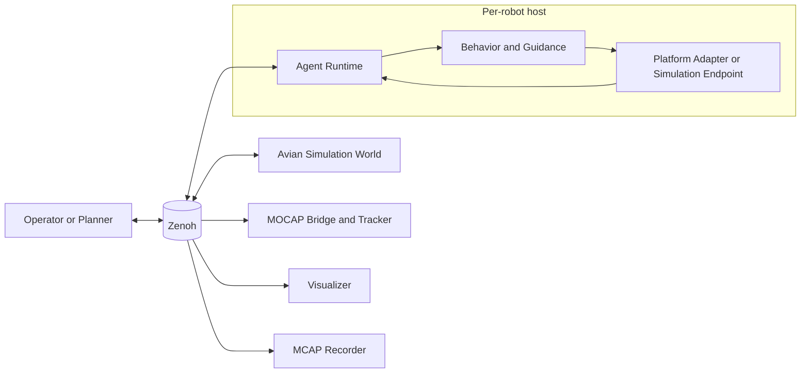
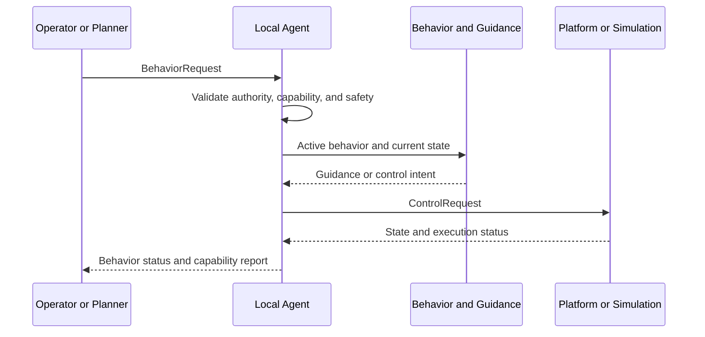

# Distributed Collaborative Autonomy Platform

A Rust workspace for research on **decentralized, agent-scoped autonomy for multi-robot systems**.

The platform gives each robot a local runtime that receives behavior requests, checks authority and safety constraints, translates behaviors into platform-agnostic guidance, and connects to simulation or hardware execution backends.

> **Project status:** Research prototype. The repository is intended for reproducible experimentation and software architecture exploration; it is not certified for safety-critical deployment.

## Research focus

This project explores a systems architecture in which autonomy is distributed across robot-local agents rather than implemented as a single fleet-wide controller.

The current implementation emphasizes:

- Explicit behavior and control contracts.
- Per-agent authority, capability, and lifecycle checks.
- Separation between behavior reasoning and platform execution.
- Repeatable simulation and hardware-integration paths.
- Middleware-based communication and observable runtime state.

## Current scope

Implemented behavior primitives include:

- `navigate-to`
- `move-away`
- `hold`
- `pick`
- `place`

The workspace currently includes:

- Per-agent backend selection: `simulated`, `hardware`, or `hybrid`.
- A Spot platform adapter using a sidecar execution path.
- An Avian simulation backend.
- A MOCAP bridge and object tracker.
- Optional visualization and MCAP recording observers.
- Shared typed contracts and Zenoh middleware integration.

The following are intentionally outside the current scope:

- A fleet-wide central controller.
- A general mission-strategy or planner framework in the runtime.
- Production certification or safety-critical operational guarantees.

## Architecture

Each robot owns an agent runtime. The runtime is responsible for admission and execution decisions, while platform adapters and simulation endpoints handle physical or simulated control.



### Behavior execution flow



## Repository layout

| Path | Purpose |
| --- | --- |
| `apps/dca` | Launcher and Ratatui operator interface |
| `crates/agent` | Per-agent admission, authority, and runtime decisions |
| `crates/autonomy` | Behavior and guidance transformations |
| `crates/contracts` | Shared contracts and protobuf generation/conversion |
| `crates/middleware-zenoh` | Zenoh transport and session utilities |
| `platforms/spot` | Spot profile and sidecar runtime integration |
| `simulation/avian` | Simulation and hybrid-world backend |
| `sensors/mocap` | MOCAP bridge and object tracker |
| `observers/visualizer` | Read-only visualization observer |
| `observers/mcap-recorder` | Read-only MCAP logging observer |
| `tests` | Rust and Python tests |
| `third_party` | Pinned dependency patches with upstream attribution |

## Getting started

### Prerequisites

- A Rust toolchain with Rust 2024 edition support.
- Operating-system libraries required by Bevy and Avian.
- Optional vendor SDK access and authorized credentials for hardware experiments.

### Run the simulation-focused application

From the repository root:

```bash
cargo run --locked
```

Use the setup UI to select a simulation-only configuration. No physical robot is required for this path.

## Validation

Run the workspace validation commands from the repository root:

```bash
rustc validate.rs -O -o target/validate
./target/validate --quality-checks-only
./target/validate --tests-only
```

Run the Python sidecar tests independently:

```bash
python3.10 -m unittest discover -s tests/python -p 'test_*.py' -v
```

The same Rust and Python validation paths run automatically on pushes and pull requests via GitHub Actions in `.github/workflows/ci.yml`.

## Documentation

- [`OVERVIEW.md`](OVERVIEW.md) — architecture boundaries and system overview.
- [`DOCUMENTATION.md`](DOCUMENTATION.md) — source-level implementation mapping.
- [`MOCAP.md`](MOCAP.md) — MOCAP integration details.

## Hardware and safety

Hardware integrations can move physical systems. Use only authorized credentials and approved network access. Follow vendor and operator safety procedures, test in controlled environments, and operate physical systems only with appropriate supervision.

Simulation and automated tests should be preferred during development whenever possible.

## License and project status

The workspace metadata currently declares `LicenseRef-Proprietary` and `publish = false` in `Cargo.toml`. This repository does not currently declare an OSI-approved open-source license.
